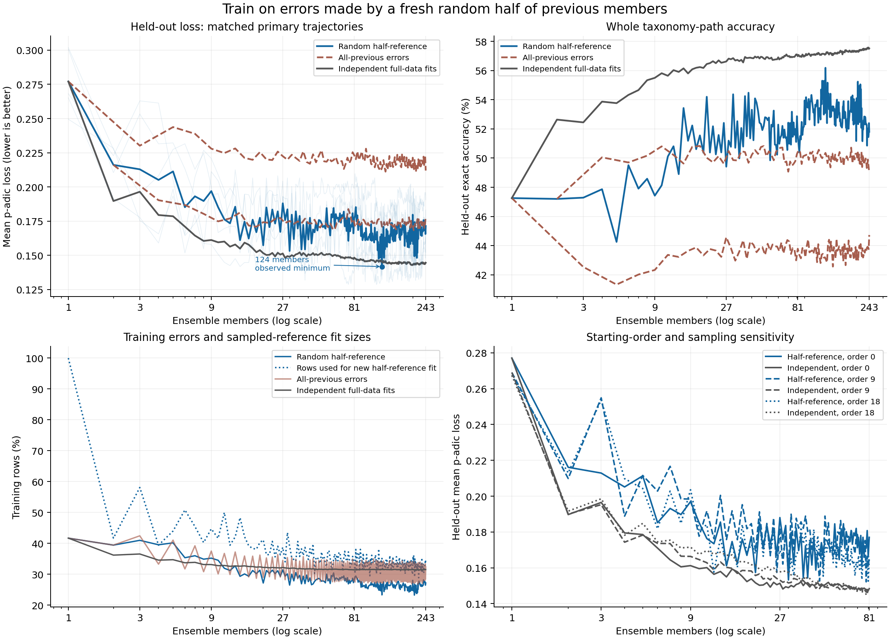

# Random half-reference ensemble results

The paper is unchanged. This experiment tests a fresh random half of previous members as the reference for identifying each next member’s training errors.

At 243 members, the new method has mean held-out p-adic loss **0.171412**, versus 0.211987 for all-previous error training and 0.144596 for independent fits. Exact-path accuracy is 51.80%, 44.72% and 57.52%, respectively.

Its best observed primary prefix is **124 members, loss 0.141769**. This was selected after scoring, so it is an exploratory observation, not a validated stopping rule.

The all-previous control oscillates between even and odd sizes. Its 243-member score represents the worse odd-size branch; the full curves and comparisons below retain both branches.

## Matched primary curves

Numbers are equal-fold means over the same five folds. Loss is p-adic distance, not an error percentage. Smaller loss is better.

| Members | Independent loss | All-previous error loss | Half-reference loss | Half-reference exact accuracy |
| ---: | ---: | ---: | ---: | ---: |
| 1 | 0.277064 | 0.277064 | 0.277064 | 47.26% |
| 3 | 0.196485 | 0.230156 | 0.212884 | 47.29% |
| 9 | 0.161197 | 0.227984 | 0.196946 | 47.43% |
| 15 | 0.159282 | 0.221222 | 0.174653 | 51.19% |
| 27 | 0.151346 | 0.222480 | 0.188016 | 49.41% |
| 45 | 0.150952 | 0.218019 | 0.174031 | 52.43% |
| 81 | 0.148368 | 0.223168 | 0.177003 | 51.56% |
| 124 | 0.145633 | 0.171090 | 0.141769 | 56.19% |
| 135 | 0.144178 | 0.212575 | 0.167863 | 52.83% |
| 243 | 0.144596 | 0.211987 | 0.171412 | 51.80% |



## Best observed primary prefix for each method

| Method | Members | Mean loss | Exact accuracy |
| --- | ---: | ---: | ---: |
| Random half of previous members | 124 | 0.141769 | 56.19% |
| All previous members | 202 | 0.168413 | 50.03% |
| Independent fits | 197 | 0.142809 | 57.35% |

All three best-prefix selections are descriptive, using the same held-out folds. Their values are potentially optimistic and are not independent model-selection results.

## Comparisons across all tested sizes

The new method has lower mean loss than independent fits in **6/402** multi-member configurations across the three fixed orders. The first primary size with lower loss is 124.

The new method has lower mean loss than all-previous error training in **349/402** multi-member configurations across the three fixed orders. The first primary size with lower loss is 3.

These are correlated size/order configurations on the same data, not independent trials or a significance test. The main table includes the observed primary minimum in addition to the predeclared display sizes.

The following are all prefixes with lower mean loss than the matched independent control:

| Order | Members | Half-reference loss | Independent loss | Folds with lower loss | Exact accuracy difference (percentage points) |
| ---: | ---: | ---: | ---: | ---: | ---: |
| 0 | 124 | 0.141769 | 0.145633 | 3/5 | -0.96 |
| 18 | 12 | 0.157602 | 0.167643 | 5/5 | -0.74 |
| 18 | 14 | 0.161259 | 0.166994 | 4/5 | -2.36 |
| 18 | 16 | 0.160249 | 0.163225 | 3/5 | -2.32 |
| 18 | 30 | 0.155148 | 0.157387 | 3/5 | -0.98 |
| 18 | 32 | 0.155636 | 0.155736 | 3/5 | -1.33 |

These exceptions do not establish consistent superiority; whole-path accuracy can move differently from the hierarchical p-adic loss.

## Starting-order and sampling sensitivity

| Order | Half-reference loss at 81 | Independent loss at 81 | All-previous error loss at 81 | Half-reference accuracy |
| ---: | ---: | ---: | ---: | ---: |
| 0 | 0.177003 | 0.148368 | 0.223168 | 51.56% |
| 9 | 0.166247 | 0.147171 | 0.209708 | 52.94% |
| 18 | 0.165084 | 0.147137 | 0.221519 | 53.56% |

Each order uses its matched seed sequence. The subset-sampling stream is keyed by order and fold, so these checks vary both starting order and reference samples. Beyond 81 only the primary order was extended.

## Late-size behaviour

| Members | Mean loss | Root accuracy | Exact training errors | Rows used for this member | Stored coefficients | Active terms per prediction |
| ---: | ---: | ---: | ---: | ---: | ---: | ---: |
| 27 | 0.188016 | 81.33% | 31.44% | 38.73% | 16423.0 | 34.19 |
| 45 | 0.174031 | 82.73% | 28.22% | 35.33% | 26406.2 | 56.38 |
| 81 | 0.177003 | 82.43% | 28.37% | 33.92% | 45733.0 | 100.24 |
| 135 | 0.167863 | 83.34% | 27.45% | 31.90% | 73904.8 | 165.28 |
| 243 | 0.171412 | 82.99% | 27.21% | 35.12% | 129093.2 | 295.00 |

Across sizes 135–243, the new half-reference mean over even sizes is 0.163115; the mean over odd sizes is 0.168452; the absolute difference is 0.005337.

Across sizes 135–243, the all-previous mean over even sizes is 0.172546; the mean over odd sizes is 0.217317; the absolute difference is 0.044772.

Mean loss across primary sizes 81–135 is 0.163852; across 135–243 it is 0.165808. These descriptive averages show no sustained improvement in the later range, despite the isolated minimum at 124. They do not define a stopping rule.

This parity comparison describes the measured curves. It was not used to tune the sampling rate, select members or stop fitting. Finite curves cannot establish an asymptotic floor. Active terms exclude defaults and consensus search; member counts do not represent a fixed storage or computation budget.

## Algorithm and verification

Before member t, sample ceil((t−1)/2) earlier members uniformly without replacement. Use the same fresh subset for every training row at that step, decode its equal-weight p-adic consensus, and fit only whole-path errors. Defaults use those selected rows only. All fitted members still vote on all products at prediction time. The original training-fold candidate codebook, coordinate fitting and inference rule are unchanged. Held-out labels never choose masks, random samples, seeds or stopping points.

The new batch is `bb57fea7-2e63-441a-ab03-16e853671090`, source `a5593abb87cddaf7592ac6db2f9cdf9c9ed0f780`. Controls come from validated batch `06577b0c-a433-42bd-b8cd-a865838c11ad`. The snapshot digest is `039175941ed2a2ec888bc6c7314c3c5f8afac1201ff604413dedb55641706222` (6,693 products, 2,542 binary features, 363 paths).

All 15 trajectories passed replay and independent fit audits, including 3,049,156 coordinate checks and 100 reference-vote checkpoints against the existing decoder. Samples, masks, integer predictions and defaults were reconstructed. Full votes were also checked against the existing decoder and scores against two integer implementations. The first two prefix predictions reproduce the previous error-only controls exactly. All 4,050 old control rows matched their saved database evidence.

Private samples, row indices, fitted coefficients and product predictions remain in Shopify Postgres under the new batch in `padjective.residual_ensemble_*`; tables and indexes use `pg_default`. Exported files contain aggregate scores, fingerprints and provenance only. The five folds have been reused for earlier experiments, so this is exploratory evidence on the established dataset rather than independent confirmation.

[Protocol](../half-reference-ensemble-protocol.md) · [Aggregate evidence](results.json) · [Summaries and paired differences](summary.json)

Rebuild this report:

```sh
uv run -m padjective.half_reference_report \
  --results docs/half-reference-ensemble/results.json \
  --output-dir docs/half-reference-ensemble
```
