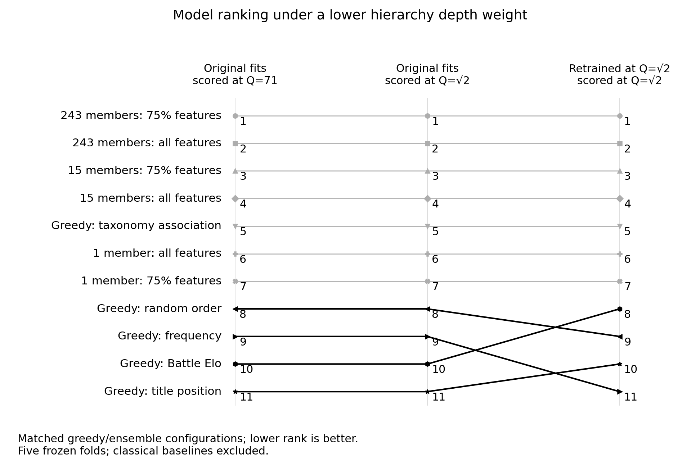

# Low-Q retraining and ranking results

Completed experiment `low-q-2026-11-02-v2` on the fixed 6,693-product benchmark.

New ensemble endpoints use 243 members, both full and 75% feature masks.
The original 243-member controls are rescored separately. The classical prediction tables
use different populations and are excluded from this matched comparison.

Fixed-fit rescoring preserves 11 of 11 ranks at sqrt(2), and 11 of 11 at Q=2.
After retraining, the first 7 positions remain in order at sqrt(2), and the first 7 at Q=2.

## Q=sqrt(2)

| Configuration | Original loss at Q=71 | Original fits scored at sqrt(2) | Retrained loss at sqrt(2) | Ranks: original / rescored / retrained |
|---|---:|---:|---:|---:|
| 243 members: 75% features | 0.134655 | 0.281243 | 0.273704 ± 0.010255 | 1 / 1 / 1 |
| 243 members: all features | 0.144596 | 0.285396 | 0.274346 ± 0.012223 | 2 / 2 / 2 |
| 15 members: 75% features | 0.147371 | 0.295097 | 0.287091 ± 0.008620 | 3 / 3 / 3 |
| 15 members: all features | 0.159282 | 0.302371 | 0.290001 ± 0.011413 | 4 / 4 / 4 |
| Greedy: taxonomy association | 0.263237 | 0.382977 | 0.375888 ± 0.015864 | 5 / 5 / 5 |
| 1 member: all features | 0.277064 | 0.404623 | 0.403131 ± 0.023662 | 6 / 6 / 6 |
| 1 member: 75% features | 0.288919 | 0.427129 | 0.421615 ± 0.017258 | 7 / 7 / 7 |
| Greedy: random order | 0.312856 | 0.440463 | 0.437159 ± 0.013157 | 8 / 8 / 9 |
| Greedy: frequency | 0.319671 | 0.445082 | 0.454918 ± 0.012610 | 9 / 9 / 11 |
| Greedy: Battle Elo | 0.324925 | 0.446094 | 0.427848 ± 0.026036 | 10 / 10 / 8 |
| Greedy: title position | 0.342006 | 0.458507 | 0.454572 ± 0.012287 | 11 / 11 / 10 |

## Q=2

| Configuration | Original fits rescored | Retrained | Exact accuracy: original → retrained |
|---|---:|---:|---:|
| 243 members: 75% features | 0.214187 | 0.207292 ± 0.010234 | 57.385% → 57.816% |
| 243 members: all features | 0.220990 | 0.210147 ± 0.011290 | 57.524% → 58.092% |
| 15 members: 75% features | 0.227829 | 0.222530 ± 0.006429 | 56.058% → 56.344% |
| 15 members: all features | 0.237247 | 0.229473 ± 0.009860 | 55.810% → 56.203% |
| Greedy: taxonomy association | 0.328285 | 0.326333 ± 0.011865 | 49.815% → 49.991% |
| 1 member: all features | 0.347028 | 0.345974 ± 0.025747 | 47.256% → 47.417% |
| 1 member: 75% features | 0.365902 | 0.359982 ± 0.018777 | 44.416% → 44.789% |
| Greedy: random order | 0.382990 | 0.382178 ± 0.011061 | 43.730% → 43.791% |
| Greedy: frequency | 0.387075 | 0.392152 ± 0.019219 | 42.877% → 42.459% |
| Greedy: Battle Elo | 0.391201 | 0.379656 ± 0.022910 | 43.630% → 44.687% |
| Greedy: title position | 0.404434 | 0.405541 ± 0.016065 | 42.284% → 42.281% |

## The two 243-member endpoints

At Q=sqrt(2), the 75% minus 100% feature mean loss difference is -0.000642; the paired fold SD is 0.007072. The 75% model has lower loss in 2 of five folds. These describe observed fold variation, not a confidence interval.

At Q=2, the 75% minus 100% feature mean loss difference is -0.002855; the paired fold SD is 0.006087. The 75% model has lower loss in 3 of five folds. These describe observed fold variation, not a confidence interval.

## Secondary frozen-model check

The original 243-member full-feature and 75%-feature loss curves cross near Q=1.0674.
This holds those original fits fixed and does not add another training setting.
See [crossing calculation](fixed-crossover.json).

## Scope and reproducibility

Each score is an equal-weight mean of the five stored fold means. Random-order seeds
are averaged within fold. The ± values describe sample fold SD, not confidence intervals.
Training and scoring weights are separate: the middle and right columns use the same
evaluation metric, so their difference measures the effect of retraining and its matching
consensus rule. This is exploratory reuse of existing folds, with no new independent test set.

Algorithm SHA-256: `f349eb35b45697cbf42eae9ba39a55001d239fad2fb2cf6e77b884021c269a8a`.
Snapshot digest: `039175941ed2a2ec888bc6c7314c3c5f8afac1201ff604413dedb55641706222`.
Private fitted coefficients and individual predictions remain in Shopify PostgreSQL.
See [protocol](protocol.md) and [aggregate results](results.json).

Run `python -m padjective.paper_low_q_experiment --members 243 --workers 12 --output results.json`
against Shopify PostgreSQL, then `python -m padjective.low_q_results results.json`.
