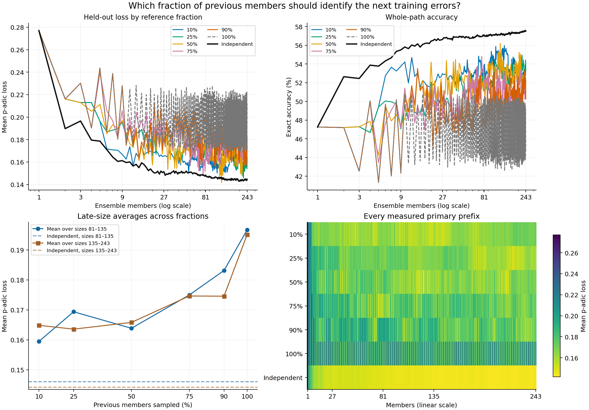
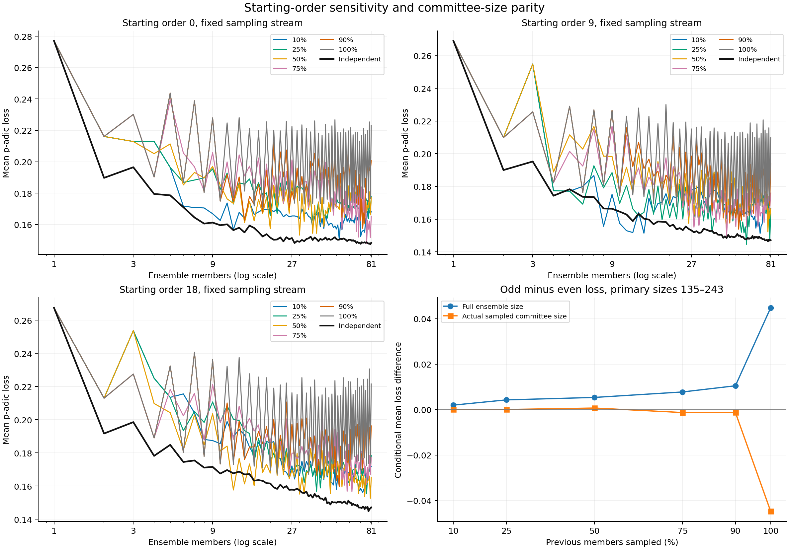
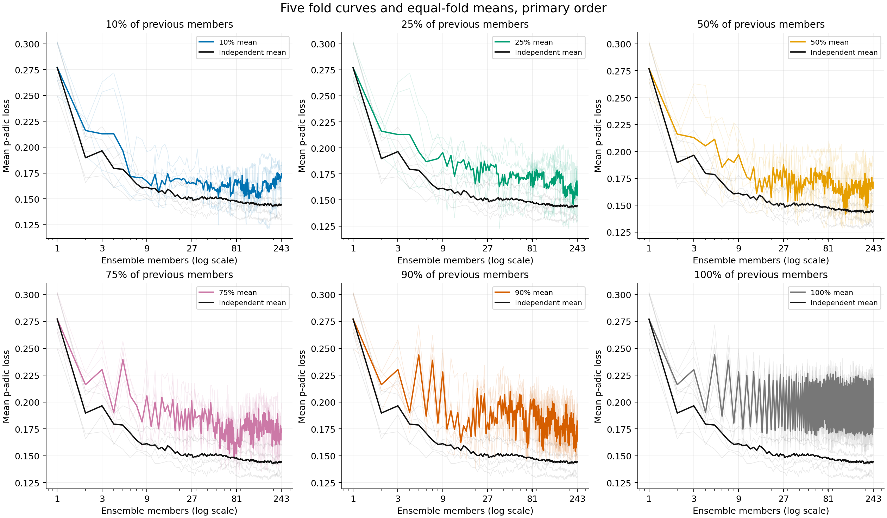

# Reference committee fraction sweep

The paper and earlier reports are unchanged. New 10%, 25%, 75% and 90% experiments are compared with the validated 50%, 100% and independent controls. All values use the same 6,693 products and five frozen folds.

## Findings

At 243 members, 25% has the lowest loss among the error-focused variants (0.164174, exact accuracy 53.22%). Independent fits give loss 0.144596 and exact accuracy 57.52%.

The three lowest late-window losses, from best to worst, use 25%, 10%, 50%. The best fraction changes from 10% over sizes 81–135 to 25% over sizes 135–243. These averages support a broad region of better performance, without establishing one optimal fraction or stopping size.

At the fixed 81-member and 243-member budgets, every error-focused variant has higher mean loss than the matched independent ensemble. This also holds at 81 members in both additional starting orders. Occasional lower-loss prefixes exist, but were found by examining many correlated sizes and do not establish a reliable gain.

Smaller reference fractions reduce the measured full-ensemble odd/even oscillation. The remaining oscillation makes endpoints alone misleading, without establishing a causal effect of committee-size parity. The late curves still fluctuate; the sweep does not locate a common saturation point.

## Fixed-budget and late-size comparison

Lower mean p-adic loss is better. Loss is hierarchical distance, not an error percentage. Each prefix score is an equal-fold mean. Window means average these prefix scores and describe the curve; they are not independent repetitions.

| Fraction | Loss at 81 | Loss at 243 | Exact accuracy at 243 | Root accuracy at 243 | Mean loss, sizes 81–135 | Mean loss, sizes 135–243 |
| ---: | ---: | ---: | ---: | ---: | ---: | ---: |
| 10% | 0.168080 | 0.174260 | 52.13% | 82.70% | 0.159459 | 0.164843 |
| 25% | 0.177636 | 0.164174 | 53.22% | 83.71% | 0.169363 | 0.163566 |
| 50% | 0.177003 | 0.171412 | 51.80% | 82.99% | 0.163852 | 0.165808 |
| 75% | 0.165147 | 0.171904 | 50.97% | 82.95% | 0.174963 | 0.174624 |
| 90% | 0.200853 | 0.182235 | 50.26% | 81.91% | 0.183134 | 0.174559 |
| 100% | 0.223168 | 0.211987 | 44.72% | 78.95% | 0.196682 | 0.195137 |
| Independent | 0.148368 | 0.144596 | 57.52% | 85.65% | 0.145979 | 0.144150 |



## Loss across ensemble sizes

| Fraction | 9 members | 27 members | 81 members | 135 members | 243 members |
| ---: | ---: | ---: | ---: | ---: | ---: |
| 10% | 0.166853 | 0.165420 | 0.168080 | 0.165035 | 0.174260 |
| 25% | 0.195452 | 0.183675 | 0.177636 | 0.170683 | 0.164174 |
| 50% | 0.196946 | 0.188016 | 0.177003 | 0.167863 | 0.171412 |
| 75% | 0.205761 | 0.201170 | 0.165147 | 0.175514 | 0.171904 |
| 90% | 0.227984 | 0.181178 | 0.200853 | 0.187314 | 0.182235 |
| 100% | 0.227984 | 0.222480 | 0.223168 | 0.212575 | 0.211987 |
| Independent | 0.161197 | 0.151346 | 0.148368 | 0.144178 | 0.144596 |

The 100% curve has a strong odd/even oscillation. All-prefix figures and window averages retain both branches; the 243-member endpoint is an odd member count. A single endpoint can therefore misrepresent the whole curve.

## Matched comparisons with independent fits

| Fraction | Lower-loss configurations / 402 | Primary loss difference at 243 | Folds with lower loss at 243 | Exact accuracy difference at 243 (points) |
| ---: | ---: | ---: | ---: | ---: |
| 10% | 6/402 | +0.029663 | 0/5 | -5.39 |
| 25% | 5/402 | +0.019577 | 2/5 | -4.30 |
| 50% | 6/402 | +0.026815 | 0/5 | -5.72 |
| 75% | 1/402 | +0.027307 | 1/5 | -6.55 |
| 90% | 0/402 | +0.037639 | 0/5 | -7.27 |
| 100% | 0/402 | +0.067390 | 0/5 | -12.80 |

These size/order configurations reuse the same observations and are correlated. Counts are descriptive comparisons, not binomial trials or significance tests. Per-fold paired differences against independent and 50% fits are retained in summary.json.

## Starting-order and sampling sensitivity at 81 members

| Fraction | Primary order 0 | Order 9 | Order 18 | Orders below matched independent loss |
| ---: | ---: | ---: | ---: | ---: |
| 10% | 0.168080 | 0.166286 | 0.171668 | 0/3 |
| 25% | 0.177636 | 0.163159 | 0.178466 | 0/3 |
| 50% | 0.177003 | 0.166247 | 0.165084 | 0/3 |
| 75% | 0.165147 | 0.175934 | 0.177202 | 0/3 |
| 90% | 0.200853 | 0.193902 | 0.196248 | 0/3 |
| 100% | 0.223168 | 0.209708 | 0.221519 | 0/3 |
| Independent | 0.148368 | 0.147171 | 0.147137 | — |

The three orders vary both the initial member order and its sampling stream. They are sensitivity checks on the same five folds. Only the primary order was extended beyond 81; no unbalanced mean across orders is used at larger sizes.



## Ensemble parity and actual committee parity

The table conditions on sizes 135–243 of the primary ensemble. Positive odd-minus-even differences mean odd counts had higher loss. Each conditional mean is first computed within fold, then averaged over folds. The raw counts per fold are retained in summary.json.

| Fraction | Full ensemble odd-minus-even loss | Sampled committee odd-minus-even loss | Committee members used to fit member 243 |
| ---: | ---: | ---: | ---: |
| 10% | +0.001964 | +0.000058 | 25 |
| 25% | +0.004258 | +0.000024 | 61 |
| 50% | +0.005337 | +0.000672 | 121 |
| 75% | +0.007749 | -0.001311 | 182 |
| 90% | +0.010462 | -0.001274 | 218 |
| 100% | +0.044772 | -0.044772 | 242 |

Fraction, rounded committee size, parity and ensemble age change together. These groupings reveal associations in the measured sequences; they do not isolate a causal parity effect. The same label-free RNG key is used at every fraction; sample counts change, and sampled sets need not be nested.

## Observed primary minima

Every prefix was scored. The following minima are selected after looking at the same held-out folds and can be optimistic. They are not validated rate choices or stopping rules. Compare them with the fixed-budget and window tables above.

| Fraction | Members at observed minimum | Loss | Matched independent loss | Exact accuracy |
| ---: | ---: | ---: | ---: | ---: |
| 10% | 110 | 0.150229 | 0.145966 | 55.88% |
| 25% | 220 | 0.145944 | 0.143697 | 54.95% |
| 50% | 124 | 0.141769 | 0.145633 | 56.19% |
| 75% | 76 | 0.147885 | 0.148674 | 54.81% |
| 90% | 232 | 0.154294 | 0.144895 | 53.43% |
| 100% | 202 | 0.168413 | 0.143253 | 50.03% |
| Independent | 197 | 0.142809 | 0.142809 | 57.35% |

## Training mechanism and storage at 243

| Fraction | Reference errors used for fit | Full ensemble exact training errors | Correct rows overturned by last member | Stored coefficients | Active terms per held-out prediction |
| ---: | ---: | ---: | ---: | ---: | ---: |
| 10% | 38.28% | 29.82% | 40.0 | 144116.6 | 304.64 |
| 25% | 32.92% | 25.79% | 88.2 | 135443.8 | 298.86 |
| 50% | 35.12% | 27.21% | 140.2 | 129093.2 | 295.00 |
| 75% | 32.62% | 25.95% | 109.0 | 125214.6 | 292.87 |
| 90% | 29.22% | 27.09% | 246.4 | 122327.8 | 290.88 |
| 100% | 28.38% | 32.40% | 1110.8 | 120027.8 | 290.65 |

Stored coefficients and active consultations are different counters. Active terms exclude defaults, consensus search and the training-time reference-vote work. A member is not a fixed unit of storage, latency or training cost.



## Protocol, validation and scope

For each new member, sample ceil(percent × previous_count / 100) previous models uniformly without replacement. One fresh committee is shared by all training rows at that step. Fit only its whole-path errors, starting coefficients at zero and fitting the default on selected rows alone. Keep all original feature columns and the original training-fold candidate paths. All fitted members vote on every product at inference. Held-out labels never determine samples, masks, seeds, weights or stopping.

The 50% sampling stream is unchanged byte for byte. Fractions use the same seed keys and coordinate fit seeds. The first member trains normally. Each member must complete a no-improvement sweep under the p=71, precision-7 integer objective; limits are 100 sweeps and 300 seconds. New fits finish before any new held-out scoring.

Sweep `b7ebd4cf-3a4f-4764-af52-e55cb35d1cff`; fitting source `f02104faf5bd6ca7b04dfe9b47ff804a1e0bdd61`; snapshot digest `039175941ed2a2ec888bc6c7314c3c5f8afac1201ff604413dedb55641706222`. The snapshot contains 6,693 products, 2,542 binary features and 363 paths, drawn directly from Shopify Postgres.

All 60 new trajectories passed, including 12,541,976 supported-coordinate checks on actual training subsets, 400 independent reference-decoder checkpoints and 6,075 unchanged control rows. All samples/masks were replayed; integer predictions and defaults reconstructed; full votes checked against the existing prefix decoder; and scores matched under two integer implementations. Initial prefixes matched the 100% control through sizes 2, 2, 4 and 10 for 10%, 25%, 75% and 90%.

The original 50% and 100% evidence was reused from validated batches. New private coefficients, samples, selected row indices, predictions and histories remain in the `padjective.residual_ensemble_*` child batches. The master manifest/report is in `padjective.reference_fraction_sweeps`. All tables and indexes use `pg_default`. Only aggregate evidence and fingerprints are exported.

The six fractions and many nested prefixes reuse the established folds. This is an exploratory extension, not new independent test data. Finite late-size behaviour cannot prove an asymptotic floor. No manuscript files were changed.

[Protocol](../reference-fraction-sweep-protocol.md) · [Full aggregate evidence](results.json) · [Summaries, paired differences and parity groups](summary.json)

Child batches:

| Fraction | Batch |
| ---: | --- |
| 10% | `c5d125c7-3e79-469d-a5ad-823f203ee476` |
| 25% | `35b732b5-bb5f-42e1-8ce1-ce000ec3943a` |
| 75% | `5a0480ed-4465-4057-8513-f6c81ad735cf` |
| 90% | `e39bd3e9-4ee4-4ee4-a8b6-d7838cf7836b` |

Rebuild the report and figures:

```sh
uv run -m padjective.reference_fraction_report \
  --results docs/reference-fraction-sweep/results.json \
  --output-dir docs/reference-fraction-sweep
```
