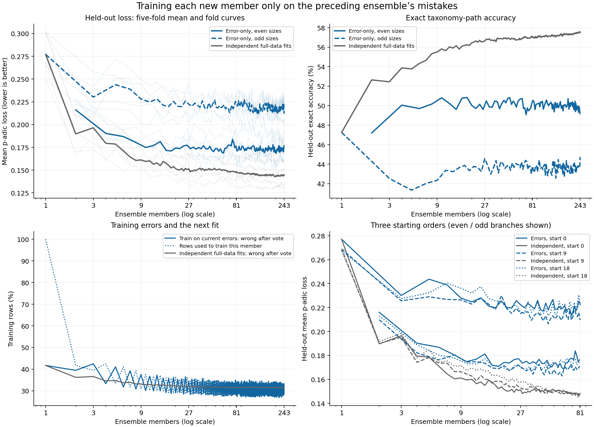

# Error-only training ensemble results

The paper has not been changed. This is an exploratory comparison on the existing five folds.

**Error-only training beats the matched independent ensemble in 0 of 402 tested multi-member configurations.** The one-member controls are identical. Each configuration is a starting order and member count, scored over the same five folds; the configurations are correlated, not independent statistical trials.

The primary error-only run has its lowest measured mean p-adic loss at **202 members: 0.168413**, with 50.03% exact-path accuracy. At 243 members its loss is 0.211987, compared with 0.144596 for independent fits at the same size.

The best independent prefix among the 243 measured sizes is 197 members (loss 0.142809). These best sizes were observed after scoring and are not validated stopping rules.

## Matched primary results

Loss is mean p-adic distance, not an error percentage. Accuracy is whole-path exact match. Each number is an equal-weight mean across five folds.

| Members | Independent loss | Error-only loss | Difference | Independent accuracy | Error-only accuracy | Folds with lower loss |
| ---: | ---: | ---: | ---: | ---: | ---: | ---: |
| 1 | 0.277064 | 0.277064 | +0.000000 | 47.26% | 47.26% | 0/5 |
| 3 | 0.196485 | 0.230156 | +0.033671 | 52.45% | 42.53% | 1/5 |
| 9 | 0.161197 | 0.227984 | +0.066787 | 55.50% | 42.33% | 0/5 |
| 15 | 0.159282 | 0.221222 | +0.061939 | 55.81% | 43.64% | 0/5 |
| 27 | 0.151346 | 0.222480 | +0.071134 | 56.63% | 44.57% | 0/5 |
| 45 | 0.150952 | 0.218019 | +0.067067 | 56.84% | 43.80% | 0/5 |
| 81 | 0.148368 | 0.223168 | +0.074799 | 56.99% | 43.78% | 0/5 |
| 135 | 0.144178 | 0.212575 | +0.068397 | 57.18% | 44.27% | 0/5 |
| 243 | 0.144596 | 0.211987 | +0.067390 | 57.52% | 44.72% | 0/5 |



## What was trained

The first member used all training rows. Each subsequent member fitted only rows whose entire path was wrong under the current ensemble consensus. The mask was recomputed before every fit; rows could re-enter. Defaults used the selected rows only. All fitted members voted on every held-out product, using the original training-fold candidate paths and the established equal-weight p-adic consensus rule. Held-out answers never chose training rows, seeds, weights or stopping points.

The models used p=71, precision 7, zero initial coefficients, random coordinate orders, strict improvements, and a completed no-improvement sweep. The primary run went through 243 members. Two additional starting orders went through 81. Their matched controls used the same seeds with independent full-data fits from the validated bank.

## Starting-order sensitivity

| Starting bank index | Error-only loss at 81 | Independent loss at 81 | Difference | Error-only exact accuracy | Best error-only prefix through 81 |
| ---: | ---: | ---: | ---: | ---: | ---: |
| 0 | 0.223168 | 0.148368 | +0.074799 | 43.78% | 60 (0.168694) |
| 9 | 0.209708 | 0.147171 | +0.062536 | 44.65% | 58 (0.162888) |
| 18 | 0.221519 | 0.147137 | +0.074383 | 43.60% | 34 (0.167104) |

These are different starting orders on the same folds and seed bank. They are sensitivity checks, not independent datasets. Beyond 81, only the predeclared primary order was extended.

## Late-size behaviour and training mechanism

| Members | Error-only loss | Root accuracy | Exact training errors | Rows used for this member | Previously correct training rows made wrong | Stored coefficients | Active terms per prediction |
| ---: | ---: | ---: | ---: | ---: | ---: | ---: | ---: |
| 1 | 0.277064 | 72.40% | 41.71% | 100.00% | 0.0 | 733.6 | 1.36 |
| 3 | 0.230156 | 77.14% | 42.46% | 39.45% | 1245.6 | 1993.2 | 3.90 |
| 9 | 0.227984 | 77.35% | 37.52% | 30.84% | 1240.0 | 5356.2 | 11.43 |
| 15 | 0.221222 | 78.03% | 35.93% | 29.94% | 1225.6 | 8471.8 | 18.80 |
| 27 | 0.222480 | 77.89% | 34.50% | 29.09% | 1167.4 | 14542.8 | 33.23 |
| 45 | 0.218019 | 78.35% | 34.24% | 28.28% | 1176.4 | 23465.6 | 54.69 |
| 81 | 0.223168 | 77.83% | 33.80% | 27.92% | 1175.0 | 41160.8 | 97.83 |
| 135 | 0.212575 | 78.89% | 32.35% | 28.47% | 1106.4 | 67592.8 | 162.09 |
| 243 | 0.211987 | 78.95% | 32.40% | 28.38% | 1110.8 | 120027.8 | 290.65 |

The measured loss change is -0.010593 from 81 to 135 and -0.000589 from 135 to 243. Finite curves do not establish an asymptotic floor. Both member-budget comparisons and the coefficient counts matter: a member is not a fixed unit of storage or prediction work. Active terms exclude defaults and consensus search.

The every-prefix evaluation reveals a persistent **even/odd oscillation**. Over sizes 135–243, mean loss across even sizes is 0.172546; across odd sizes it is 0.217317. The figures join each parity separately to make this visible. The best prefix through 81 was 60 members (loss 0.168694), only 0.000281 above the best through 243. This is a descriptive pattern found after scoring, not a new selection or stopping rule. New members repeatedly overturn correct training predictions: the last member makes 1110.8 previously correct rows wrong per fold on average. The measured behaviour is a fluctuating plateau rather than steady convergence.

## Evidence and limitations

Batch: `06577b0c-a433-42bd-b8cd-a865838c11ad`. Fitting source: `b57fb1ef9f3dbd56d1dee587ca369bf2fa6e84d4`. Snapshot: `244ddbe3-0a2c-4c04-9436-0a0253108a09`; digest `039175941ed2a2ec888bc6c7314c3c5f8afac1201ff604413dedb55641706222`.

Audit passed for all 15 trajectories, including 2,667,033 supported coordinate checks on the actual selected training subsets. Every mask, integer prediction and training-only default was reconstructed; consensus checkpoints matched the prefix decoder, and all scores agreed under two integer metric implementations. First-member predictions matched their independent controls exactly.

The dataset has 6,693 products, 2,542 binary features and 363 paths. This remains an exploratory reuse of the established five folds. No new independent test dataset was collected. Comparing many prefixes can make the observed best size optimistic. Fold differences and starting-order variation are descriptive; no nominal significance test is applied to the correlated size points.

Private products, selected-row indices, coefficients and predictions remain in Shopify Postgres under the `padjective.residual_ensemble_*` tables. The exported JSON contains aggregate scores, fingerprints and provenance only. All new tables use `pg_default`.

Protocol: [residual-ensemble-protocol.md](../residual-ensemble-protocol.md). Raw aggregate evidence: [results.json](results.json). Fold means and paired differences: [summary.json](summary.json).

To reproduce the figures from validated aggregate evidence:

```sh
uv run -m padjective.residual_ensemble_report \
  --results docs/residual-ensemble/results.json --output-dir docs/residual-ensemble
```
